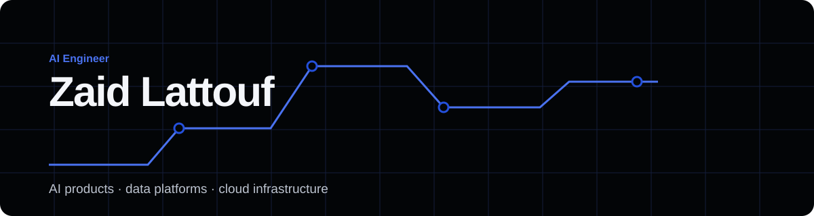

# Zaid Lattouf | AI Engineer

I build production AI systems and the data platforms behind them. My work spans agents that can act with permission, memory that stays useful as facts change, and pipelines that turn difficult source material into searchable documents.

## Selected work

**Production AI with persistent memory.** I co-led a production agent platform. The team adopted and shipped seven capabilities I built. As primary engineer for the standalone memory service, I built retrieval for changing facts and relationships and wrote the evaluation harness we used to compare configurations. I also built messaging integrations and outbound AI calling that lets an agent discuss appointment times with a service provider on someone’s behalf. [AI platform and memory service](https://zaidlt.github.io/work/agent-platform/)

**Document intelligence at scale.** I built and operated an eight-stage platform for manufacturer manuals and built 160 source collectors upstream. A small model classified clear cases from the first three pages after screening. I reserved longer reads and stronger models for uncertain cases, with a second model as the final cross-check. The pipeline checked brands and model numbers against the manual itself. **100,000+ manuals structured for AI search · September 2026.** [Document platform](https://zaidlt.github.io/work/appliance-knowledge-platform/)

**Cloud delivery and operations.** I owned environments, infrastructure as code, access, deployments and migrations across Azure and Google Cloud. I built shared scheduling and execution records for data workloads, led a production database recovery and diagnosed a separate failover fault. [Infrastructure and migrations](https://zaidlt.github.io/work/infrastructure-migrations/) · [Operations](https://zaidlt.github.io/work/cloud-operations/)

**Independent projects.** In Agent Cost Down I explored when a cheaper model can handle a task and when to escalate, with a separate check on whether the answer is correct. My scientific-data projects use public NASA data for exoplanet screening, solar forecasting, Martian ice exploration and crop-stress analysis. [Agent Cost Down](https://github.com/ZaidLT/agent-cost-down) · [Scientific data and ML](https://zaidlt.github.io/capabilities/#scientific)

**Open source.** Google ADK merged my error-handling changes, and Mastra credited my regression tests and fix for a bug that counted failed or declined tool calls as results. [Merged pull request #1156](https://github.com/google/adk-js/pull/1156) · [My bug report #28163](https://github.com/mastra-ai/mastra/issues/28163) · [Credited fix #28471](https://github.com/mastra-ai/mastra/pull/28471)

## Engineering skills

- **Agents and integrations.** Multi-agent orchestration, typed tools, structured outputs, approval steps and outbound AI calling. Google ADK, LangGraph, MCP, FastAPI, Claude API and Agent SDK, OpenAI and Gemini. Development tools include Claude Code hooks, subagents, skills and permissions, and Codex.
- **Memory and retrieval.** Fact versioning, entities and relationships, hybrid search, embeddings and source-linked retrieval. PostgreSQL, pgvector, Python and SQLAlchemy.
- **AI evaluation.** Test harnesses, adversarial examples, Recall@k and MRR, model routing, retries and budget controls. Python, pytest, SQL, NVIDIA Nemotron and Nebius Token Factory.
- **Data engineering.** Batch and streaming pipelines, provenance, schema validation, targeted recovery and release checks. Python, SQL, pandas, BigQuery, Pub/Sub, Dataflow, Azure Functions, Blob Storage and Document AI.
- **Applied ML.** Reproducible experiments, star-grouped and chronological evaluation, evidence-linked assistants and bounded calculation tools. scikit-learn, pvlib, Parquet and DuckDB.
- **Software and cloud.** APIs, identity, private networking, migration and recovery. TypeScript, React, C#/.NET, Redis, Azure Cosmos DB, Google Cloud, Azure, Docker, Terraform, Bicep and GitHub Actions.

## Education and certifications

- BEng in Electrical and Software Engineering, McGill University.
- [Claude Certified Architect - Foundations](https://www.credly.com/badges/1a44ff97-ffb7-401e-9b99-a88629b25e9d).
- Previously held Google Cloud Professional Cloud Architect, Professional Data Engineer and Associate Cloud Engineer certifications.

Remote · Canadian and Jordanian citizen

[Portfolio](https://zaidlt.github.io/) · [Capabilities](https://zaidlt.github.io/capabilities/) · [Email](mailto:zaid.lattouf@gmail.com)
