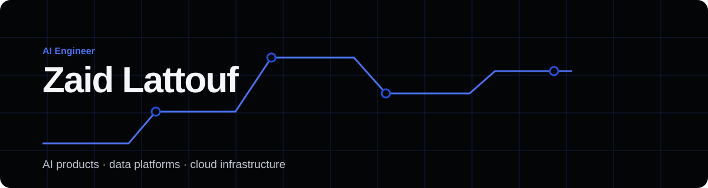

# Zaid Lattouf

**AI engineering · Data platforms · Cloud architecture**

I build production AI systems and data platforms that keep running. My work connects agent architecture, persistent memory and useful integrations with the data pipelines and cloud infrastructure behind them.

I work across design, implementation, evaluation and delivery, with particular attention to how systems handle changing information, incomplete data and failures.

## Engineering skills

### AI agents and integrations

Multi-agent orchestration, tool design, MCP integration, prompt engineering and structured outputs. Building workflows that retrieve information, use external tools and require human approval where appropriate. Model selection, context management and integration into user-facing applications.

**Stack:** Google ADK · LangGraph · Claude API and Agent SDK · OpenAI · Gemini · MCP · FastAPI  
**Development workflows:** Claude Code hooks, subagents, skills and permissions · Codex

### Memory and retrieval

Standalone memory services, entity and relationship modeling, changing facts and retained history. Retrieval-augmented generation, embeddings and hybrid search, with attention to which information should be retrieved and how it remains connected to its source.

**Stack:** PostgreSQL · pgvector · Python · SQLAlchemy

### Evaluation and model selection

Designing evaluation harnesses, test datasets, adversarial cases and independent outcome checks. Comparing retrieval configurations using Recall@k and MRR, investigating category-level failures and using the findings to guide implementation. Model routing, retries, escalation, latency measurement and spending controls.

**Stack:** Python · pytest · SQL · NVIDIA Nemotron · Nebius Token Factory

### Data engineering

Batch and streaming pipelines, ETL/ELT, orchestration and recoverable processing. Data modeling, warehouses and lakes, schema validation, deduplication, provenance and quality-controlled releases. Choosing storage and processing approaches around access patterns, reliability, performance and cost.

**Stack:** Python · SQL · pandas · PostgreSQL · BigQuery · Pub/Sub · Dataflow · Azure Functions · Blob Storage · Document AI  
**Analytical storage:** Parquet · DuckDB

### Applied ML and scientific data

Turning public datasets into reproducible experiments and interactive applications. Data validation, feature preparation, baseline models and evaluation using grouped or chronological splits to prevent leakage. Source-linked AI explanations and bounded calculation tools that connect analysis to inspectable evidence.

**Stack:** Python · pandas · scikit-learn · pvlib · DuckDB · OpenAI

### Software, cloud architecture and delivery

Backend APIs, database-backed services and interactive interfaces. Cloud architecture across compute, storage and networking; identity, access and secrets; availability, backup and disaster recovery. Infrastructure as code, automated testing, CI/CD, monitoring, migration planning and cost optimization.

**Stack:** Python · FastAPI · TypeScript · React · C#/.NET · Redis · Azure Cosmos DB  
**Cloud and delivery:** Google Cloud · Azure · Docker · Terraform · Bicep · GitHub Actions

## Selected work

### Production AI with persistent memory

- **Product delivery:** Co-led a production agent platform supporting document-grounded answers, persistent context and controlled service workflows. Seven capabilities I personally built were adopted by the production team and shipped.
- **Personal ownership:** Served as primary engineer on the standalone memory service, covering relationships, changing facts, version history and retrieval. Built voice and messaging integrations and agent-accessible backend tools.
- **Engineering evidence:** Authored a retrieval evaluation harness, compared alternative configurations and used category-level failures to inform representation and ranking choices.

[Explore the AI platform and memory service →](https://zaidlt.github.io/work/agent-platform/)

### Document intelligence at scale

- **Acquisition:** Built **160 source collectors** and acquired **370,000 documents**, supported by shared processing, provenance, deduplication, retries and cost controls.
- **Processing:** Designed and operated an **eight-stage AI-assisted platform** for extraction, classification, source-grounded identity checks, structured output and publication review. Used targeted recovery to improve difficult documents without discarding trustworthy work.
- **Delivery:** The production-clean catalog held **110,000+ manuals in September 2026**. Structured outputs preserved document identity and source references to support downstream retrieval.

[Explore the document platform →](https://zaidlt.github.io/work/appliance-knowledge-platform/)

### Cloud delivery and operations

- **Architecture and delivery:** Owned environments, infrastructure as code, access, deployments and migrations across Azure and Google Cloud. Created staging and modernized development and production.
- **Operational ownership:** Built shared scheduling, execution records and monitoring for data workloads. Led production database migration recovery and investigated a separate failover fault, carrying the lessons into monitoring and runbooks.

[Architecture and migrations →](https://zaidlt.github.io/work/infrastructure-migrations/) · [Operations and recovery →](https://zaidlt.github.io/work/cloud-operations/)

### Independent AI and scientific applications

[**Agent Cost Down**](https://github.com/ZaidLT/agent-cost-down) explores model routing and escalation to control the cost of agent execution, with separate checks for whether an attempt ran successfully and whether its result was correct.

My independent NASA-data projects combine reproducible pipelines, machine learning, geospatial or scientific interfaces and source-linked AI assistants. They extend my work into exoplanet screening, solar forecasting, Martian ice evidence and regional crop-stress analysis.

## Education and certifications

- **BEng in Electrical and Software Engineering**, McGill University.
- [**Claude Certified Architect - Foundations**](https://www.credly.com/badges/1a44ff97-ffb7-401e-9b99-a88629b25e9d).
- Previously held **Google Cloud Professional Cloud Architect**, **Professional Data Engineer** and **Associate Cloud Engineer** certifications.

Remote · Canadian and Jordanian citizen

[Portfolio](https://zaidlt.github.io/) · [Capabilities](https://zaidlt.github.io/capabilities/) · [Career](https://zaidlt.github.io/cv/) · [Email](mailto:zaid.lattouf@gmail.com)
