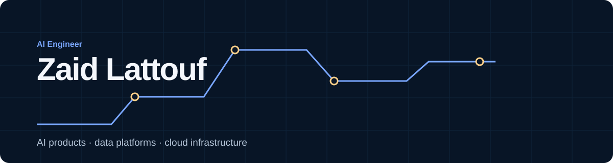

# Zaid Lattouf

**AI Engineer · Agent systems, data pipelines and cloud infrastructure**

I build AI agents that retrieve knowledge, retain context and carry out approved actions. My work also spans document-processing pipelines and cloud architecture, from infrastructure as code and deployment to migrations and incident recovery.

### Selected engineering work

- **Agents that take useful action.** Co-led a 16-agent home operations platform and shipped seven production capabilities across document intelligence, persistent memory and service workflows. Built repair-provider calling workflows with explicit user approval and duplicate-action controls. [Agent platform](https://zaidlt.github.io/work/agent-platform/)

- **Data prepared for retrieval.** Built 160 source collectors and acquired 370,000 documents. Classification, filtering and deduplication removed duplicates and out-of-scope material; 110,000+ structured Markdown documents were prepared for retrieval. [Data pipelines](https://zaidlt.github.io/work/appliance-knowledge-platform/)

- **Retrieval measured against expected answers.** Authored a memory evaluation harness with 303 facts and 729 queries. OpenAI + Markdown achieved 93.8% Recall@3 in the April 2026 experiment. [Retrieval evaluation](https://zaidlt.github.io/work/historical-evaluation/)

- **Cloud ownership through deployment and recovery.** As the only cloud engineer, owned environments, infrastructure as code, migrations and incident recovery across Azure and Google Cloud. Corrected stale coverage metrics and alert logic, reducing sources needing manual attention from 14 to 1. [Infrastructure](https://zaidlt.github.io/work/infrastructure-migrations/) · [Operations](https://zaidlt.github.io/work/cloud-operations/)

### Engineering background

Previously, I co-founded an engineering and prototyping venture in Montréal, built data-cleaning tools for enterprise ERP migrations, and modernised ERP/CRM and online sales workflows for a pharmaceutical wholesaler in Amman.

BEng in Electrical and Software Engineering, McGill University.

**Python · SQL · TypeScript · Google ADK · FastAPI · MCP · PostgreSQL / pgvector · Azure · Google Cloud · Terraform · Bicep · GitHub Actions**

[Portfolio](https://zaidlt.github.io/) · [Career](https://zaidlt.github.io/cv/) · [zaid.lattouf@gmail.com](mailto:zaid.lattouf@gmail.com)

Available in two weeks · remote · working with teams worldwide. Worked Eastern Time hours.

Canadian and Jordanian citizen · Arabic, English and French.
